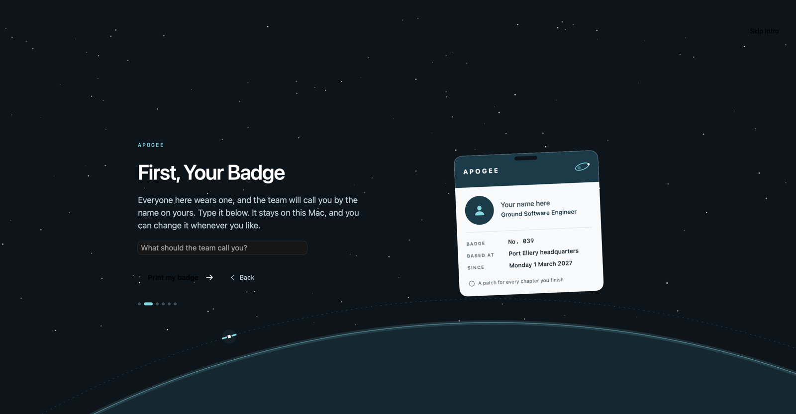
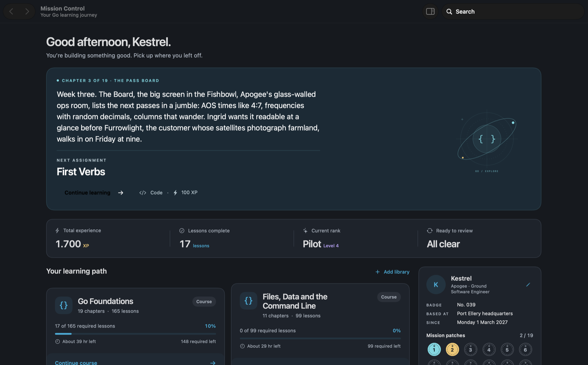
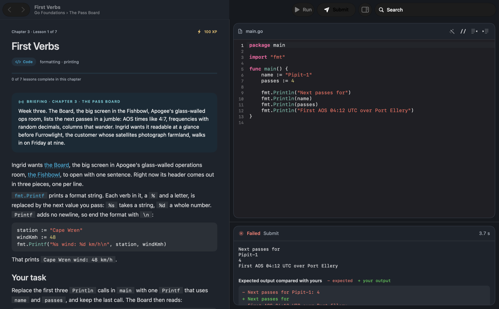
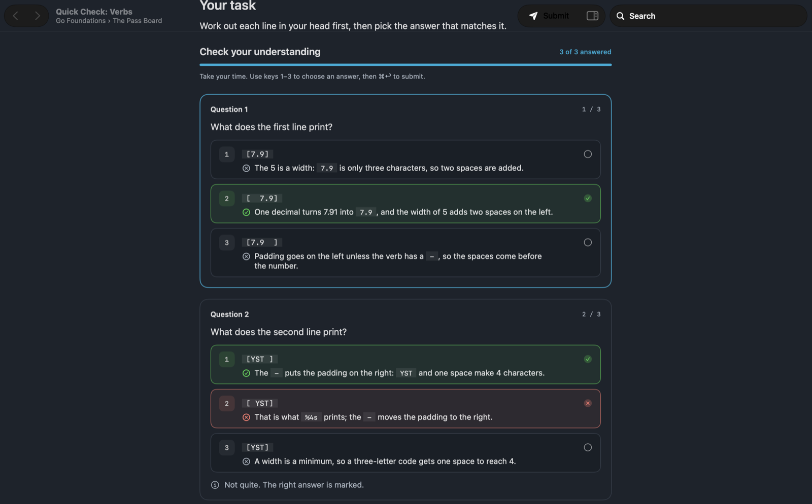
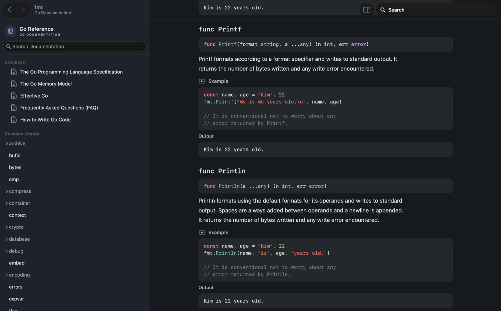
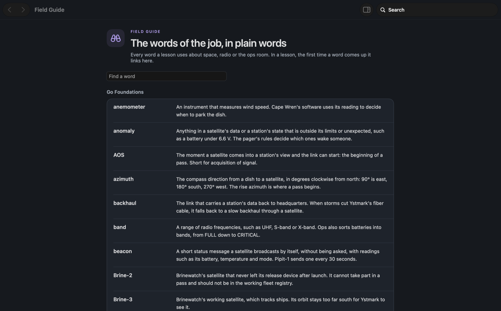

# Gosmos

A quiet, native macOS app for learning Go by doing: courses on the left, the lesson in the
middle, the Go toolchain built into the app checking your code. Short lessons, hints when you
are stuck, and spaced review. No browser, no local web server, no account, no network, no
pictures or videos.

The app is not tied to any course. It reads **libraries**: SQLite files holding a syllabus,
in the format described in `docs/library-format.md`. Any file in that format plugs in and
works the same way. The courses that ship with the app are the libraries built from
`courses/`; File › Open Library… opens any other.

`courses/apogee/` holds the Apogee courses, as text that `make library` builds into
`courses/apogee.sqlite`: original lessons set at Apogee, an
invented small space company whose radio dishes talk to satellites, planned in
`docs/apogee/`. They are told as a story (`docs/storytelling.md`): an opening that gives you
your badge, a briefing and a debrief for every chapter, a mission patch for each one you
finish, and a field guide that explains every word of that world in plain language. Everything
in them is written for Gosmos. The path from here to production Go is ismatsamadov/gosmos#18.

## A look inside

Every course starts with a story. Early in Go Foundations' opening you get your Apogee badge,
made out in the name you give it:

Mission Control shows where you left off: the next assignment with its chapter's briefing,
your experience, rank and mission patches, and every course with what is left of it.

A lesson is its readme beside your code. A chapter's first lesson opens with the chapter's
briefing, and the world's words link to the field guide. Submit builds and runs your code with
the Go built into the app, and compares what it prints with what it should, line by line:

A quiz explains every answer, the right one and each wrong one:

The Go documentation is built in and works offline: the standard library with its examples,
the spec, the memory model, Effective Go, the FAQ and How to Write Go Code.

The field guide explains every word of Apogee's world in plain language, and a lesson links
each word the first time it uses it:

## Two databases

- A **library** is content only: courses, chapters and lessons, starter and solution files,
  hints, quizzes with explanations. The app opens it read-only and never writes to it. Every
  part of a lesson has its own table, and keys, foreign keys and checks keep bad data out: a
  quiz question has one right answer, and only a lesson checked by what its program prints
  has expected output. Every lesson is checked on the Mac: a program or its tests with the
  built-in Go, a quiz by its answers. `db/schema.sql` explains each table.
- The **learner database**, `~/Library/Application Support/Gosmos/learner.sqlite`, holds
  everything that is yours: progress, every Run and Submit, notes, your code, the hints and
  solutions you looked at, and your review schedule. `db/learner.sql` explains each table.
  Each user's learner database is created empty; no personal study data ships in the
  repository or app.

Nothing is kept as JSON or loose files. To build and run your code the app writes a lesson's
files to a scratch folder and reads them back; the database is where they live. The app
never runs git and syncs nothing.

## A new laptop

`gh repo clone ismatsamadov/gosmos`, then `make install` in it, and open Gosmos.

## Parts

| Path | What it is |
|---|---|
| `courses/` | The course libraries built into the app, as text: `apogee/`, a folder for each course, chapter and lesson, that `make library` builds into `apogee.sqlite` |
| `reference/go.sqlite`, `cmd/reference/` | The Go reference built into the app, read offline: the standard library's docs and examples, the spec, the memory model, Effective Go, the FAQ and How to Write Go Code; `make reference` remakes it, `docs/reference-format.md` says how |
| `db/schema.sql` | A library's tables, constraints and conventions (format 9) |
| `db/learner.sql` | The learner database's tables |
| `db/` | The Go package that creates, opens and checks libraries; `db/history/` keeps the learner database's first schema, for the test of the app's step from it |
| `cmd/library/` | Go tool for any library: `create`, `check`, `verify`, `drift` |
| `cmd/author/`, `internal/` | Go tool: builds a library from its folder of text, writes lessons and a course's story into a library from packages, and exports them back |
| `cmd/passes/` | Go tool: the passes of the Apogee world, from the pass model every pass in its courses comes from |
| `scripts/pkgcheck.sh` | Checks lesson packages before the library is built: readme rules, hints, 30 runs, `-race`, failing starters |
| `app/` | The app: a Swift package with GosmosKit and the SwiftUI app |
| `vendor/`, `app/Packages/Vendor/`, `reference/website/` | Every outside dependency, kept here so a clone builds with nothing fetched: the Go modules, the app's Swift packages, and golang/website's files for the Go reference |
| `docs/library-format.md` | The library format: what any library must hold, and what the app checks |
| `docs/architecture.md` | How the pieces fit together, and why |
| `docs/design.md` | How the app looks and behaves |
| `docs/apogee/` | The Apogee courses: their world, their Go syllabus, a sample chapter |
| `docs/authoring.md` | How lessons, chapters and courses are added and fixed: the tools, the steps, the checks, the world's numbers, seeing it in the app (`app/scripts/snapshot.sh`) |
| `docs/images/` | The pictures above, drawn by the app itself with `app/scripts/snapshot.sh` (dark appearance, a 1600×1000 window, the sidebar cropped off) |
| `Makefile` | `make install` builds and installs the app; `make library` builds the courses; `make test`, `make check`, `make verify` |

## Requirements

- To use Gosmos: macOS 27 or later, nothing else. The app carries its own Go toolchain and
  works offline; you install nothing, and it never needs the internet.
- To build it: the Xcode Command Line Tools (`xcode-select --install`) and Go 1.27 or later.
  `make app` builds the Go it runs with into the app; `GO_ROOT=<folder>` picks another Go.
  Every dependency is in the repository, so once it is cloned, nothing is fetched.

## License

Gosmos is free for individual learners' private, noncommercial study under the
[Gosmos Personal Learning License](LICENSE). You may build and run it, complete its courses,
and make private changes for your own learning. Commercial use, organizational deployment,
teaching others, redistribution, and publishing modified versions require a separate written
license from Ismat Samadov. Learning skills for a future job is allowed, and your independently
authored work remains yours.

These terms cover Gosmos's original code and content. Third-party components, kept with their
licenses in `vendor/`, `app/Packages/Vendor/` and `reference/website/`, and the Go reference
retain their own licenses; see [the reference credits](docs/reference-format.md#credit).
The full terms are in [LICENSE](LICENSE), also included in built apps at
`Contents/Resources/LICENSE`. This is a restricted personal learning license, not an open source
license.
